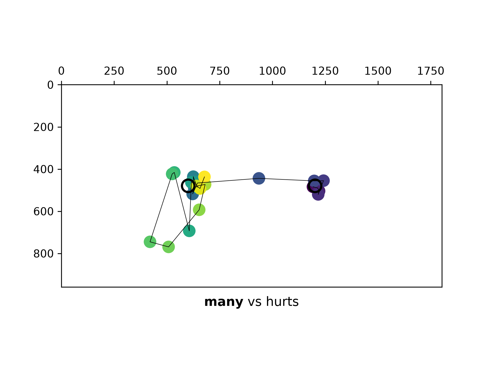

# Combining Maze and eye-tracking

This example uses [SaccadeJS](https://saccade.jspsych.org/) to collect eyetracking data during the
maze experiment. It is otherwise the same as the base example and uses the plugin unmodified.

## Process the data

SaccadeJS adds a lot of data to the base plugin.

See [`output-sample.json`](output-sample.json) for an example of what the data might look like.

To make it easier to process, we include
[an example script](https://github.com/LoicGrobol/jspsych-maze-demo/tree/main/examples/eye-tracking/visualiser)
that processes a whole output of the example timeline and output simple gaze maps like this one:

[](https://github.com/LoicGrobol/jspsych-maze-demo/tree/main/examples/eye-tracking/map-sample.png)

You can run the visualizer like this after installing its dependencies:

```bash
pip install -U -r requirements.lst
python visualiser/render-et.py {{ path to an output json file }} {{ path to an output directory }}
```

However, in real settings, it would probably make more sense to rather use it as inspiration to
write data visualization adapted to what you mean to study and the specific outputs of your
experiment.
